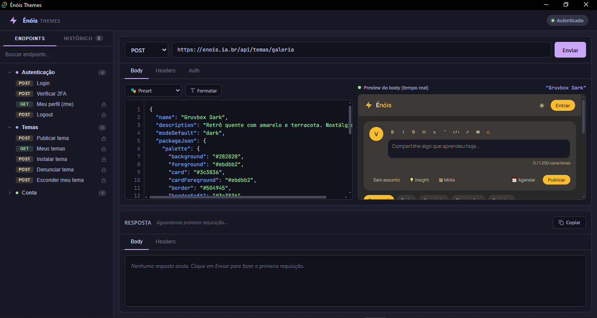

# Énóis Themes

Aplicativo desktop para **criar, testar e publicar temas visuais** na galeria do [Énóis](https://enois.ia.br) — com preview em tempo real, presets de paleta e histórico de requisições.



---

## ✨ O que ele faz

- **Login automático**: ao autenticar, o token da sessão é capturado e salvo — você não precisa copiar/colar em cada request.
- **Preview em tempo real**: conforme você edita o JSON do tema, um mockup do feed do Énóis se atualiza na hora ao lado.
- **9 presets prontos**: Catppuccin Mocha/Latte, Nord, Tokyo Night, Gruvbox, Rosé Pine, Solarized, Dracula, Cyberpunk.
- **Split view 50/50**: body e preview lado a lado, com syntax highlighting e números de linha.
- **Drafts por endpoint**: se você fechar o app no meio da edição, ao voltar o body continua lá.
- **Respostas em cache por endpoint**: cada endpoint tem sua própria resposta salva — trocar de tela não perde histórico.
- **Histórico de requisições**: os últimos 50 requests ficam persistidos.
- **Atalhos**: `Ctrl+Enter` envia, `Ctrl+S` formata o JSON.

---

## 🎯 Como usar

### 1. Primeiro acesso — fazer login

Ao abrir o app pela primeira vez, você verá o endpoint **Login** já selecionado na barra lateral.

1. No **Body**, preencha suas credenciais do Énóis:
   ```json
   {
     "email": "seu@email.com",
     "password": "sua-senha"
   }
   ```
2. Clique em **Enviar** (ou `Ctrl+Enter`).
3. Se o login for bem-sucedido, você verá:
   - O badge no topo muda para **🟢 Autenticado**
   - Um toast verde: **"🔐 Login realizado — token salvo automaticamente"**
   - A resposta `200 OK` com o `token` que será usado em todas as próximas chamadas.

> **Nota:** se sua conta tem **2FA** ativo, o login retorna `202` com um desafio. Use o endpoint **Verificar 2FA** e cole o código do app autenticador.

---

### 2. Publicar um tema

Com o token salvo, clique em **Temas → Publicar tema** na barra lateral.

A tela fica em **split 50/50**:

```
┌─────────────────────────┬─────────────────────────┐
│  Body (JSON do tema)    │  Preview do feed        │
│  ─────────────────────  │  ─────────────────────  │
│  {                      │  ┌───────────────────┐  │
│    "name": "...",       │  │  Énóis            │  │
│    "packageJson": {     │  │  [composer]       │  │
│      "palette": {       │  │  [post card]      │  │
│        "primary": ...   │  │  [post card]      │  │
│      }                  │  └───────────────────┘  │
│    }                    │                         │
│  }                      │  cores aplicadas ✅     │
└─────────────────────────┴─────────────────────────┘
```

**Três formas de começar:**

**🅰️ Usar um preset** — escolha um tema pronto no dropdown **🎭 Preset** (acima do body). O body é substituído automaticamente (com confirmação se você já tiver editado algo).

**🅱️ Editar o body manualmente** — troque cores no JSON e veja o preview reagir a cada tecla:
```json
{
  "name": "Meu Tema",
  "description": "Descrição curta",
  "modeDefault": "dark",
  "packageJson": {
    "palette": {
      "background": "#1e1e2e",
      "foreground": "#cdd6f4",
      "primary": "#cba6f7",
      "primaryForeground": "#1e1e2e",
      "success": "#a6e3a1",
      "error": "#f38ba8"
    }
  }
}
```

**🅲 Copiar de um tema existente** — abra **Meus temas**, veja o JSON de qualquer tema publicado e cole em **Publicar tema** para fazer uma variante.

**Quando estiver satisfeito:**
- Clique em **Enviar** (ou `Ctrl+Enter`).
- Se o tema passar pelo gate de contraste da API (≥ 4.5:1), você recebe **`201 Created`** com o `id` do tema publicado.

---

### 3. Gerenciar temas existentes

| Endpoint | O que faz |
|---|---|
| **Meus temas** | Lista todos os temas que você já publicou |
| **Instalar tema** | Aplica um tema à sua conta (cole o `themeId` na URL) |
| **Denunciar tema** | Envia um tema para moderação |
| **Esconder meu tema** | Remove da galeria pública sem apagar |
| **Salvar tema da conta** | Define qual tema é o padrão da sua conta |

**Dica:** sempre que precisar de um `themeId`, copie o valor `"id"` da resposta de **Meus temas**.

---

### 4. Atalhos de teclado

| Atalho | Ação |
|---|---|
| `Ctrl+Enter` | Enviar requisição |
| `Ctrl+S` | Formatar JSON |
| `Esc` | Fechar toasts/modais |

---

### 5. O que acontece entre sessões

O app usa `localStorage` para persistir:

- **Token de sessão** — você continua logado ao reabrir o app
- **Drafts por endpoint** — o body em edição de cada endpoint é salvo automaticamente (debounce de 500ms)
- **Respostas em cache** — cada endpoint guarda a última resposta recebida
- **Histórico** — os últimos 50 requests ficam salvos
- **Presets e preferências** — dropdown de presets, aba da barra lateral, etc.

**Para limpar tudo:** abra o DevTools (`Ctrl+Shift+I`) e rode `localStorage.clear()`, ou use **Auth → Esquecer token salvo** para remover só o token.

---

## 📦 Instalação e desenvolvimento

### Pré-requisitos

| Ferramenta | Versão | Necessário para |
|---|---|---|
| [Node.js](https://nodejs.org) | 18+ | Frontend (Vite + TypeScript) |
| [Rust](https://rustup.rs) | 1.77+ | Backend (Tauri) |
| [Visual Studio Build Tools](https://visualstudio.microsoft.com/visual-cpp-build-tools/) | 2022, com carga **"Desenvolvimento para desktop com C++"** | Linker MSVC no Windows |
| [WebView2](https://developer.microsoft.com/microsoft-edge/webview2/) | — | Já vem no Windows 10/11 |

> **No Windows:** após instalar o Rust, confirme que o toolchain MSVC está ativo:
> ```powershell
> rustup default stable-msvc
> rustup show
> ```
> Se o `cargo` reclamar de `link.exe not found`, o Visual Studio Build Tools não está completo — reinstale com a carga C++.

### Clonar e rodar em dev

```powershell
git clone https://github.com/Solvezera/enois-themes.git
cd enois-themes
npm install
npm run tauri dev
```

A primeira compilação demora ~3-5 minutos (Rust compila ~150 crates). Depois disso, o HMR do Vite deixa as edições do frontend instantâneas.

### Build para produção

```powershell
npm run tauri build
```

Gera o instalador em:
- **Windows:** `src-tauri/target/release/bundle/msi/enois-themes_0.1.0_x64_en-US.msi`
- Também gera `.exe` (NSIS) em `src-tauri/target/release/bundle/nsis/`

O `.msi` é autocontido (~10-15 MB) e inclui a runtime — o usuário final não precisa instalar Node, Rust ou WebView2.

---

## 🛠 Stack

- **[Tauri 2](https://tauri.app)** — app desktop leve (usa WebView2 nativo do Windows)
- **[Rust](https://www.rust-lang.org)** — backend nativo via `reqwest` para HTTP
- **[Vite](https://vitejs.dev)** — dev server e bundler
- **[TypeScript](https://www.typescriptlang.org)** — frontend tipado
- **[Catppuccin Mocha](https://github.com/catppuccin/catppuccin)** — tema da própria interface

Por que Tauri e não Electron: o binário fica **~15 MB** em vez de ~150 MB, e o consumo de memória é ~4x menor.

---

## 📁 Estrutura

```
enois-themes/
├── src/                    # Frontend (TypeScript)
│   ├── collections.ts      # Definição dos endpoints + presets
│   ├── index.html          # Layout (sidebar, painéis, modal)
│   ├── main.ts             # Lógica (HTTP, preview, drafts, histórico)
│   └── styles.css          # Tema Catppuccin + estilos
├── src-tauri/              # Backend (Rust)
│   ├── src/
│   │   ├── lib.rs          # Comando `make_request` (reqwest)
│   │   └── main.rs         # Entry point
│   ├── Cargo.toml
│   └── tauri.conf.json     # Config da janela e build
├── package.json
├── tsconfig.json
└── vite.config.ts
```

---

## 🌐 Endpoints cobertos

A API do Énóis usada por este app:

- `POST /auth/login` — autenticação
- `POST /auth/2fa/verify` — verificação de segundo fator
- `GET  /me` — perfil do usuário
- `POST /auth/logout` — encerrar sessão
- `POST /temas/galeria` — publicar tema
- `GET  /temas/galeria/mine` — meus temas
- `POST /temas/galeria/{id}/install` — instalar tema
- `POST /temas/galeria/{id}/report` — denunciar
- `POST /temas/galeria/{id}/hide` — esconder
- `PUT  /me/theme` — salvar tema padrão da conta

Documentação completa: [enois.ia.br/docs](https://enois.ia.br)

---

## 🤝 Contribuindo

Issues e PRs são bem-vindos. Para mudanças grandes, abra uma issue primeiro para discutirmos o escopo.

```powershell
git checkout -b feat/minha-melhoria
# ... edita ...
git commit -m "feat: descrição da melhoria"
git push origin feat/minha-melhoria
# abre PR no GitHub
```

---

## 📄 Licença

MIT © Ricardo Volta

---